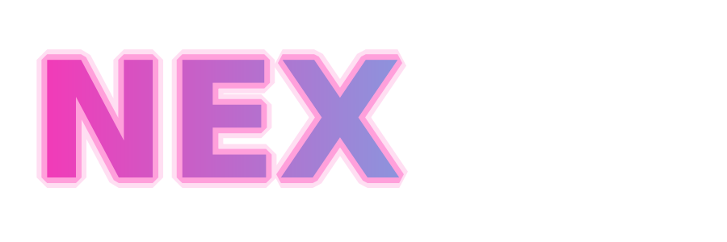
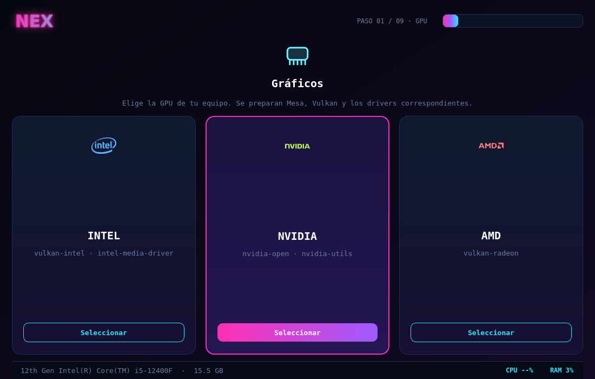
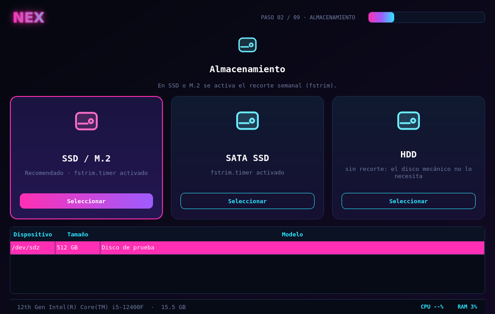
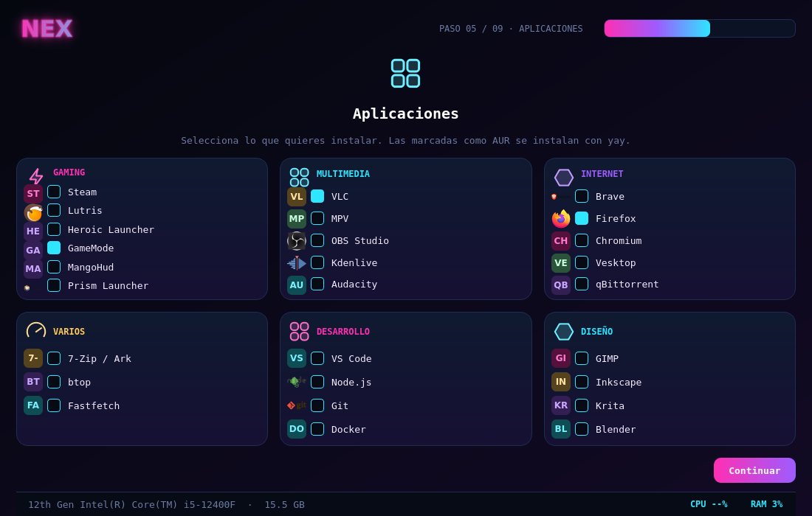
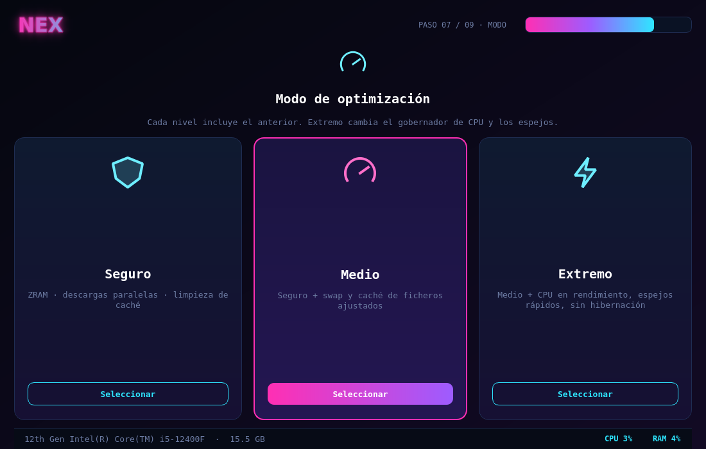
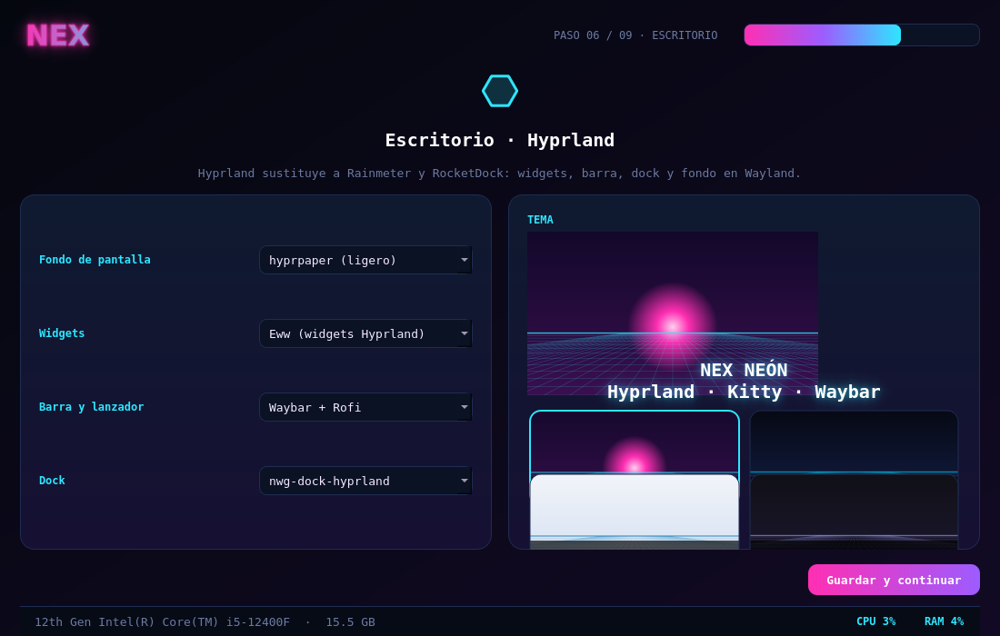
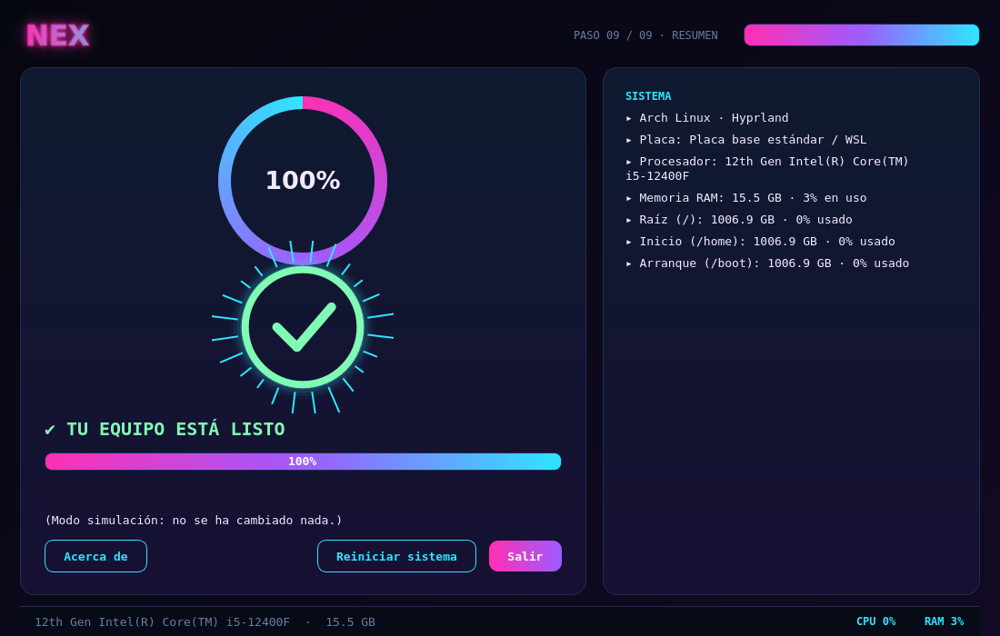

<p align="center">
  
</p>

<h1 align="center">Nex Setup · Arch Linux</h1>

<p align="center">
  Optimiza y configura Arch Linux con Hyprland, con interfaz en español, temas neón
  y un menú para elegir las aplicaciones.
</p>

<p align="center">
  
  
  
  
  
</p>

---

## ✨ Qué incluye

| Herramienta | Para qué sirve |
|---|---|
| **Asistente gráfico** (`nex_optimizador_gui.py`) | 9 pantallas: GPU, almacenamiento, equipo, oficina, apps, Hyprland, modo, limpieza y resumen. Aplica los cambios tras confirmar el plan. |
| **Menú de apps** (`nex-setup`) | Elige aplicaciones por categorías, desde `config/apps.conf`. Incluye opción HyDE. |
| **Ajustes de optimización** (`nex-optimizar.sh`) | Zram, descargas paralelas, limpieza de caché, fstrim, perfil de energía y ajustes de kernel. Versión de terminal. |

## 🖼️ Capturas

<details open>
<summary><b>Gráficos y almacenamiento</b></summary>

<p align="center">
  
  
</p>

</details>

<details open>
<summary><b>Aplicaciones con logotipos libres</b></summary>

<p align="center">
  
</p>

</details>

<details>
<summary><b>Modo de optimización y escritorio</b></summary>

<p align="center">
  
  
</p>

</details>

<details>
<summary><b>Pantalla final</b></summary>

<p align="center">
  
</p>

</details>

> Las capturas son renders de la interfaz sin pantalla real. El aspecto en tu escritorio puede variar.

## 🚀 Instalación rápida

```bash
git clone https://github.com/pilahito/arch-nex-setup.git
cd arch-nex-setup
sudo bash install.sh
```

Después ya tienes disponibles los comandos `nex-setup` y `nex-optimizar`.

### Probar sin cambiar nada

```bash
python3 nex_optimizador_gui.py --simular   # asistente gráfico, solo muestra el plan
bash nex-setup.sh --dry-run                # menú de apps, sin instalar
bash nex-setup.sh --list                   # ver las apps configuradas
```

### Requisitos

- Arch Linux (o derivado) con Hyprland, para el escritorio.
- `python-pyqt6` y `qt6-svg` para el asistente gráfico.
- `libnewt` (whiptail) para el menú de terminal.

## 🧩 Configurar las apps

Edita `config/apps.conf`. Cada categoría es una sección `[Nombre]`:

```ini
[Gaming]
steam | Steam | pacman | off
lutris | Lutris | pacman | off
brave-bin | Brave | aur | off
```

- `origen`: `pacman` (repos oficiales), `aur` (necesita `yay`) o `hyde`.
- `estado`: `on` (marcada por defecto) u `off`.

## 📦 Estructura

```
arch-nex-setup/
├── nex_optimizador_gui.py   interfaz gráfica (PyQt6)
├── nex_plan.py              convierte las elecciones en un plan y lo aplica
├── nex-setup.sh             menú de apps (whiptail)
├── nex-optimizar.sh         ajustes de optimización (terminal)
├── config/apps.conf         catálogo de aplicaciones por categorías
├── assets/                  fondos, logotipo y logotipos libres (ver ORIGEN.md)
├── tools/                   generador de imágenes
├── tests/                   pruebas
└── docs/capturas/           capturas de la interfaz
```

## 🧪 Pruebas

```bash
python3 -m unittest discover -s tests -v
bash tests/test_optimizar.sh
```

## 🗺️ Pendiente

- Probar la aplicación de cambios en un Arch real.
- Catálogo de escritorios Hyprland de la comunidad, con soporte de español e inglés.
- Logotipos para más aplicaciones y herramientas, solo con licencia libre.

## 🎨 Créditos y licencias

- Logotipos de aplicaciones y fabricantes: cada uno con su licencia en [`assets/logos/ORIGEN.md`](assets/logos/ORIGEN.md) y [`assets/marcas/ORIGEN.md`](assets/marcas/ORIGEN.md). Son marcas de sus titulares.
- Fondos y logotipo NEX: generados con `tools/generar_imagenes.py`.

## ❤️ Apoya el proyecto

<p align="center">
  <a href="https://paypal.me/pilahito"></a>
  <a href="https://github.com/pilahito"></a>
</p>
